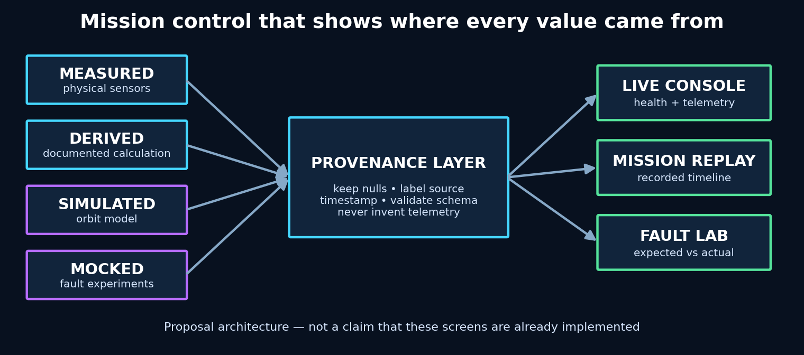

# CubeSat Sim — Mission Control Upgrade Proposal

## What this project is

A CubeSat is a small satellite built from standardized box-shaped units. The
upstream CubeSat Sim project recreates the major systems of one on a Raspberry
Pi: power, orientation, sensors, communications, data storage, and a ground
dashboard. This repository is my engineering proposal for making that dashboard
more trustworthy and useful for testing failures.

The central problem is simple: a mission-control screen can look convincing
while showing numbers that were measured, estimated, simulated, or completely
missing. My design makes the source of every value visible and separates the
fictional orbit from the real tabletop hardware.



## Engineering design choices

- **Provenance on every value:** label data as measured, derived, simulated,
  mocked, or unavailable.
- **No fake zeroes:** missing measurements remain visibly missing.
- **Separate workspaces:** real hardware telemetry and orbit simulation cannot
  be mistaken for each other.
- **Fault injection through the mock hardware layer:** test the same service
  boundaries used during normal operation instead of adding display-only tricks.
- **Reproducible experiments:** record the initial condition, injected fault,
  expected response, actual response, and recovery.
- **Honest scope:** this repository is a design proposal and does not claim the
  proposed dashboard has been implemented.

## Project scope

This document proposes an engineering-focused mission-control and fault-testing
upgrade for [miksrv/cubesat-sim](https://github.com/miksrv/cubesat-sim) and its
separate [CubeSat Ground Station](https://github.com/miksrv/cubesat-groundstation).
Both upstream projects are MIT-licensed work by their original author. This is
an independent derivative design proposal, not an official upstream roadmap and
not a claim that the proposed features are already implemented.

## What the existing system does

CubeSat Sim is flight software for a physical Raspberry Pi educational CubeSat
model. Independent Python services represent the on-board computer, electrical
power system, attitude system, payload, data handling, communications and
dashboard. They exchange messages over MQTT and can run either against physical
sensors or a mocked hardware layer on a development computer.

The mission controller moves through operational states:

```text
BOOT → STANDBY → DEPLOY → NOMINAL → LOW_POWER → SAFE → CRITICAL
```

The ground-station interface can display live MQTT telemetry, replay archived
missions and run from a bundled recording without a satellite connection.

## Problem being addressed

A mission-control display must distinguish measurements from estimates and
simulations. Earlier interface concepts included values that the physical unit
does not directly measure, including battery current, power consumption,
several radio-quality metrics and multiple subsystem temperatures. Orbital
position is also simulated because the educational unit is not an orbiting
spacecraft.

The upgrade must never turn missing data into zero or display invented values as
telemetry. Every value should carry a visible provenance:

- **Measured** — received from physical hardware.
- **Derived** — calculated from a measured value using a documented model.
- **Simulated** — generated by the orbit or hardware simulator.
- **Mocked** — generated by the development hardware abstraction layer.
- **Unavailable** — not supplied; never silently replaced with zero.

## Design direction

The proposed interface is a practical engineering console rather than a
cinematic science-fiction dashboard. It prioritizes traceability, test results
and clear failure states.

### Primary workspace

- Current platform profile and mission state.
- Live connection source: `HARDWARE`, `MOCK`, `REPLAY` or `DISCONNECTED`.
- Battery voltage, inferred percentage and voltage trend.
- Attitude and angular rate, including calibration state.
- GNSS fix state and real ground position when available.
- Service heartbeats for OBC, EPS, ADCS, PAYLOAD, DHS and COMMS.
- Host CPU, memory, storage and uptime.
- Timestamped command acknowledgements and state transitions.

### Separate simulation workspace

The fictional orbit belongs on a dedicated page labeled **ORBIT SIMULATION**.
It must not appear to be the physical unit's location. The simulation may show:

- Earth-centered orbit and ground track.
- Altitude and orbital velocity.
- Eclipse and daylight periods.
- Ground-station visibility windows.
- Simulated satellite attitude.
- Mission elapsed time and playback speed.

The real GNSS location remains in the hardware workspace.

## Fault-injection laboratory

Fault injection should operate through the mocked hardware and MQTT boundaries,
not through special-case display code. Each experiment records its initial
conditions, injected fault, expected response, actual response and recovery.

### Proposed faults

| Fault | Injection point | Expected behavior |
|---|---|---|
| Battery discharge | Mock power monitor | `NOMINAL → LOW_POWER → SAFE → CRITICAL` at configured thresholds |
| Charger failure | Mock power monitor | External-power claim rejected when pack voltage continues falling |
| IMU loss | Mock IMU | ADCS reports unavailable data; deployment or health policy reacts |
| IMU drift | Mock IMU | Attitude diverges visibly without being presented as calibrated truth |
| GNSS loss | Mock GNSS | Fix becomes false; last coordinates remain explicitly stale |
| Payload camera failure | Mock camera | Command receives a bounded error and no invented image |
| MQTT delay | Test transport | Heartbeats age and service-health indicators change |
| MQTT message loss | Test transport | Missing status is distinguished from a reported zero value |
| Radio interruption | Mock radio | COMMS becomes unavailable while unrelated services continue |
| Subsystem crash | Service harness | OBC health policy enters the documented safe response |
| Storage exhaustion | Mock filesystem boundary | Capture/recording fails explicitly without crashing flight services |
| Host overload | Mock host metrics | Dashboard reports load while mission logic remains deterministic |

### Experiment report

Every run should export a machine-readable JSON record and a concise human
report containing:

- Software revision and configuration hash.
- Data source and hardware/mock status.
- Start and end timestamps.
- Fault parameters.
- Expected state sequence.
- Observed state sequence and transition timing.
- Relevant telemetry window.
- Pass, fail or inconclusive verdict.
- Recovery steps and final system condition.

## Proposed architecture

```text
Physical sensors ─┐
                  ├─ Hardware abstraction layer ─ Flight services ─ MQTT
Mocked sensors ───┘                                      │
                                                        ├─ Live source
Mission database ────────────────────────────────────────┼─ Replay source
Recorded fixture ────────────────────────────────────────┘
                                                         │
                                                Ground-station UI
                                                         │
                                     Telemetry • Commands • Test reports
```

Flight services remain the authority for telemetry shapes and mission policy.
The interface consumes those contracts but does not invent additional sensor
values. A fault-testing controller is permitted only in mock or explicit test
profiles so a public dashboard cannot inject failures into physical hardware.

## Implementation phases

1. **Contract audit** — inventory every displayed field and classify it as
   measured, derived, simulated, mocked or unavailable.
2. **Interface redesign** — rebuild the main workspace around source labels,
   service health, mission state and defensible telemetry.
3. **Simulation separation** — move orbit visualization to an explicitly
   simulated workspace.
4. **Fault API** — add typed mock-driver controls with a strict test-profile
   boundary.
5. **Fault panel** — create experiments, show expected reactions and provide
   recovery controls.
6. **Test reporting** — export reproducible JSON and readable reports.
7. **Integration testing** — verify MQTT messages, state transitions, dashboard
   rendering and recovery end to end.
8. **Hardware validation** — compare mock assumptions with physical behavior
   and document remaining uncertainty.

## Definition of done

The upgrade is complete only when:

- No interface field claims a measurement the hardware cannot provide.
- Missing values remain unavailable rather than becoming zero.
- Simulated orbit information is visibly separated from physical telemetry.
- Every supported fault has a reproducible automated test.
- Fault runs produce expected-versus-actual reports.
- Normal flight services operate unchanged when fault testing is disabled.
- Mock, replay and physical-hardware modes are unmistakable.
- Upstream copyright and MIT license notices remain intact.

## Current status

**Design proposal only.** The existing repositories have been inspected, but
the mission-control redesign and fault-injection panel described here have not
yet been implemented or hardware-validated.
